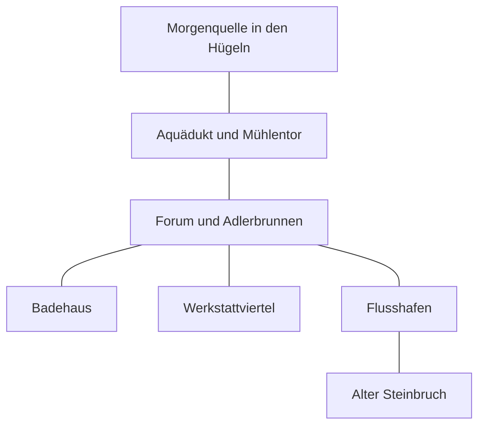

# Valdora – was ihr zu Beginn kennt

Die Orientierung ist erzählerisch, nicht maßstabsgetreu. Diese Karte zeigt nur öffentlich bekannte Orte.

| Weg | Ungefähre Reisezeit |
|---|---|
| Forum ↔ Badehaus oder Werkstattviertel | wenige Minuten, keine eigene Zeitphase |
| Forum ↔ Flusshafen | etwa 15 Minuten, nur bei ausgedehnter Aktion eine Phase |
| Forum ↔ Mühlentor | etwa 30 Minuten, eine Zeitphase |
| Mühlentor ↔ Morgenquelle | etwa 30 Minuten, eine Zeitphase |
| Hafen ↔ alter Steinbruch | etwa 30 Minuten, eine Zeitphase |

Der Weg zum Steinbruch ist allgemein bekannt; was sich dort befindet, wisst ihr noch nicht. Neue Orte ergänzen wir erst, wenn eure Figuren davon erfahren. Aus einer Kartenlinie folgt keine geheime Wasserverbindung.

## Von Livia erklärt – Speicherpunkt 5

Das Wasser kommt aus der Morgenquelle, läuft durch den Aquädukt und wird über Leitungen beim Mühlentor in die Stadt geführt. Dort kann der Zufluss kontrolliert werden. Zum Mühlentor etwa 30 Minuten, zum Steinbruch über den Hafen insgesamt etwa 45 Minuten. Eine Verbindung der aktuellen Störung zum Steinbruch ist noch nicht bewiesen.

## Getrennt erfahren – Speicherpunkt 8

Cäsar kennt den Wartungsweg vom Mühlentor zum Verteilerhaus durch die Wache. Augustus weiß durch Neria, dass dort die Schieber liegen; die genaue Wegbeschreibung hat sie ihm erst angeboten. Keine dieser neuen Informationen ist bisher zwischen den Helden ausgetauscht worden.

## Gemeinsam erreicht – Speicherpunkt 9

Beide Helden sind im Verteilerhaus, über Wartungsweg vom Mühlentor bzw. äußeren Pfad vom Steinbruch. Sichtbare Wasserverbindungen: Morgenquelle → Verteilerbecken; von dort je ein Ausgang zur Stadt und zum Reservebecken im Steinbruch.
