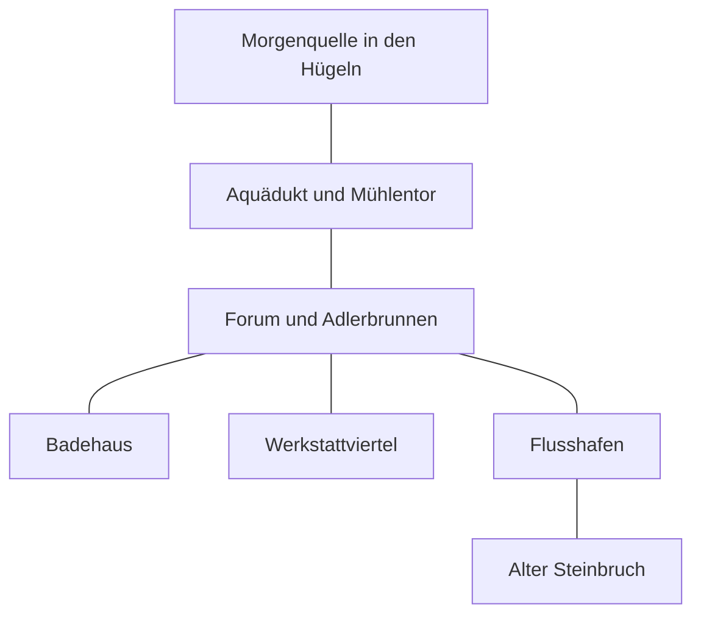

# Valdora – was ihr zu Beginn kennt

Die Orientierung ist erzählerisch, nicht maßstabsgetreu. Diese Karte zeigt nur öffentlich bekannte Orte.

| Weg | Ungefähre Reisezeit |
|---|---|
| Forum ↔ Badehaus oder Werkstattviertel | wenige Minuten, keine eigene Zeitphase |
| Forum ↔ Flusshafen | etwa 15 Minuten, nur bei ausgedehnter Aktion eine Phase |
| Forum ↔ Mühlentor | etwa 30 Minuten, eine Zeitphase |
| Mühlentor ↔ Morgenquelle | etwa 30 Minuten, eine Zeitphase |
| Hafen ↔ alter Steinbruch | etwa 30 Minuten, eine Zeitphase |

Der Weg zum Steinbruch ist allgemein bekannt; was sich dort befindet, wisst ihr noch nicht. Neue Orte ergänzen wir erst, wenn eure Figuren davon erfahren. Aus einer Kartenlinie folgt keine geheime Wasserverbindung.
